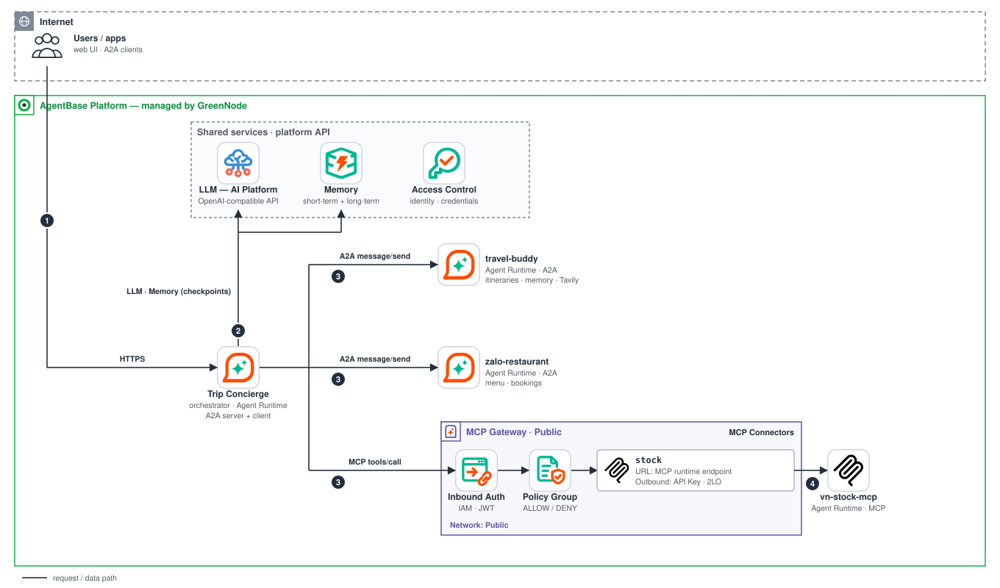

# Trip Concierge — One Agent That Delegates to Other Agents (A2A + MCP)

[](https://github.com/GreenNode-Samples/sample-multi-agent-a2a/actions/workflows/ci.yml)
[](LICENSE)

> A **multi-agent** sample on **GreenNode AgentBase**: an orchestrator agent (LangGraph on Agent Runtime) answers one composite request by **delegating over the A2A protocol** to the agents you already deployed from the other samples, and **over MCP** (MCP Gateway + Policy Group) to a tool server. It shows how the existing samples compose into a system, and the production concerns of doing that: discovery, identity, timeouts, partial failures, side effects, and defence in depth.

| Role | Sample | Protocol |
|---|---|---|
| Itinerary | [sample-travel-buddy](https://github.com/greennode-samples/sample-travel-buddy) | A2A (`travel-buddy`) |
| Restaurant booking | [sample-zalo-restaurant](https://github.com/greennode-samples/sample-zalo-restaurant) | A2A (`zalo-restaurant-bot`) |
| Stock data | [sample-mcp-stock-server](https://github.com/greennode-samples/sample-mcp-stock-server) | MCP through the MCP Gateway |

---

## The experience — one request, three specialists

| You say (user `alice`) | What the orchestrator does |
|---|---|
| "Plan 2 days in Da Nang next weekend for 2 people, book a table at Quán Ngon 123 on Saturday at 19:00, and tell me how tourism stocks did this week." | Splits the request and calls **in parallel**: `travel-buddy` (itinerary), `zalo-restaurant-bot` (is the table free?), the stock tools (tourism stocks). Answers once, says which agent produced what, and **asks you to confirm the booking** instead of booking on a guess. |
| "Yes, book it." | Sends the booking to `zalo-restaurant-bot` **with your explicit confirmation in the request text** (the restaurant agent also confirms: without this it would ask again and loop) and reports the booking id. |
| `zalo-restaurant-bot` is down | `TOOL_ERROR` for that part only: you get the itinerary and the stocks, plus one sentence saying the booking could not be done and an offer to retry. Nothing is invented. |

The chat UI shows every step inside the message: which agent is being asked (and with what), which tool is called, how long each took, and, with `A2A_STREAMING=1`, the partial answer of the agent while it writes.

## Architecture



- **Orchestrator** — `src/backend`: `GreenNodeAgentBaseApp`, a langchain `create_agent` with the middleware loop of [sample-travel-buddy](https://github.com/greennode-samples/sample-travel-buddy) (see [Agent loop](#agent-loop)), **one tool per remote agent** and the MCP stock tools. Its conversation state is the `AgentBaseMemoryEvents` checkpointer (one AgentBase Memory, no long-term strategy: each remote agent keeps its own memory).
- **Remote agents** — any A2A v0.3 server with a JSON-RPC endpoint and an agent card. The two samples are tested against; their code is not copied.
- **Stock tools** — `sample-mcp-stock-server` registered as the `stock` connector of an MCP Gateway. The orchestrator calls the gateway with the runtime's IAM token; the gateway's **Policy Group** decides which `stock__*` tools its principal may call.
- **The orchestrator is itself an A2A server** (card + `/a2a`, same shapes as the samples), so it can be composed further.

### How a delegation works

| Concern | How |
|---|---|
| **Discovery** | At startup (in the background, so `/health` is not delayed) and then every 10 minutes the card of each agent in `A2A_AGENTS` is read from `<url>/.well-known/agent-card.json`, in parallel. A card that cannot be loaded is **skipped with a warning and retried after 30 s**; a failure is never cached, a failed refresh keeps the previous card, and the system prompt tells the model which agents are currently unreachable so it does not improvise their work. The agent is rebuilt only when a card changed. |
| **Tool per agent** | Name = card name (letters, digits, `_`, `-`, max 64), description = card description + skills + examples (cut and flattened: a card is data from another system), one argument `request`. If a card names an RPC URL on another origin than the one you configured, the agent is rejected: the API key and the IAM token are never sent anywhere else. Redirects are not followed. |
| **Who is calling** | The user id of the turn goes to the agent as `X-GreenNode-AgentBase-User-Id`, so each agent keeps its own memory per user (travel-buddy remembers alice's diet, zalo-restaurant uses it as the guest id). The model never sees or chooses it. |
| **Conversation** | The A2A `contextId` is `<session-id>:<agent-name>` (the session id is replaced by its SHA-256 prefix when the result would exceed 128 characters), also sent as `X-GreenNode-AgentBase-Session-Id`. It is **derived, not stored**: stable across turns, restarts and replicas, different per agent and per session. Calls to the **same** remote conversation run one after the other (two concurrent turns on one remote thread would fork its history); calls to **different** agents run in parallel. |
| **Credentials** | `X-API-Key` from `A2A_AGENT_<LABEL>_API_KEY` (the agent's `AGENT_API_KEY`), and with `A2A_IAM_AUTH=1` the runtime's IAM token as `Authorization: Bearer` (the agent's *Inbound Identity: IAM Permissions*; refreshed once on a 401, same `get_token()` as the MCP client). |
| **Timeouts and retries** | One overall timeout per call, `A2A_TIMEOUT_SECONDS` (default 90). `message/send` is **not idempotent** (a booking could run twice), so a call is repeated only when it provably did not reach the agent: a connection that could not be opened, or HTTP 429. A timeout, a dropped connection or a 5xx is **never** retried. |
| **Failures** | Any failure becomes a short `TOOL_ERROR: agent 'x' failed: …` result (no trace, no raw exception) and the turn continues with the other parts. Unexpected exceptions go through `ToolErrorMiddleware`. |
| **Results** | Text is read from a `Message`, or from a `Task` (artifacts, else the status message); `input-required` is passed on as `INPUT_REQUIRED: <question>`; `failed`, `rejected`, `canceled`, `auth-required` and a task still `working` are errors. Data parts are returned as JSON, files are ignored. Replies are capped at 8,000 characters like MCP results. |
| **Guardrails** | Per turn: 10 model calls, 12 tool calls, **3 calls per remote agent**; the model may call several tools in one step (they run concurrently); context summarised above ~16,000 tokens. |
| **Streaming** | `/api/chat/stream` is an SSE stream: tokens, `delegate` / `delegate_done` / `tool` events and, with `A2A_STREAMING=1` (the agents are then called with `message/stream`), `delegate_text` with their partial answer. The final answer is always the complete reply, never the concatenated chunks. If the client disconnects the turn is cancelled, and the calls to the agents with it. |

> `message/stream` is used only for an agent whose card says `capabilities.streaming: true`; otherwise the call falls back to `message/send`.

### Limits of this sample

- Only the JSON-RPC transport. Agents whose card prefers gRPC or HTTP+JSON are skipped.
- A call must finish within one request. A `Task` that is still `submitted` / `working` is an error: there is no `tasks/get` polling, no push notifications and no resuming an `input-required` task by `taskId` (the answer to a question is sent as a new message in the same context, which is what the sample agents expect; a server that insists on the `taskId` is not supported). The sample agents answer with a `Message` and never create tasks.
- Text (and JSON data) only; file parts are ignored.

## Layout

```
├── src/backend/          # main.py (routes, A2A server) · agent.py (agent loop, delegation tools, config) · a2a_client.py (cards, message/send|stream)
│                         # mcp_client.py · agent_loop.py · requirements.txt
├── src/frontend/         # index.html · style.css · app.js (no build step)
├── tests/                # pytest: scripted LLM, fake Memory API, stub A2A agents on 127.0.0.1, MockTransport (no network)
├── compose/              # *.env.example of the sibling containers
├── docs/architecture.svg
├── Dockerfile · docker-compose.yml · .env.example · requirements-dev.txt
```

## Agent loop

`src/backend/agent.py` is the hardened core of [sample-travel-buddy](https://github.com/greennode-samples/sample-travel-buddy) with the memory tools replaced by delegation tools:

| Concern | How |
|---|---|
| Runaway loops | `ModelCallLimitMiddleware(run_limit=10)` ends the turn with a friendly Vietnamese apology; `ToolCallLimitMiddleware(run_limit=12)` and one `ToolCallLimitMiddleware(tool_name=<agent>, run_limit=3)` per remote agent refuse further calls with an error the model reads, so it still writes an answer |
| Failing tools | `ToolErrorMiddleware`: an exception in any tool becomes an error message for the model (exception type only, no trace) |
| Transient LLM errors | `ModelRetryMiddleware(max_retries=2)` on connection errors, 429 and 5xx. The only retry layer (the OpenAI client runs with `max_retries=0`) |
| Context size | `SummarizationMiddleware`: above ~16,000 tokens the older messages are replaced by a summary and the last 12 are kept; AI tool calls are never separated from their tool results |
| Current date | a dynamic prompt writes "now" in `Asia/Ho_Chi_Minh` and the unreachable agents into the system prompt on every model call |
| Tool output size | MCP results and agent replies are capped at 8,000 characters with a `...[truncated N chars]` marker |
| Checkpoint traffic | `durability="exit"`: one checkpoint write per turn instead of one per graph step |
| MCP tools | loaded from the gateway on first use and refreshed every 10 minutes; a failed or empty `tools/list` is retried on the next turn |

## Run locally

Requires **Python 3.12** (or Docker) and GreenNode resources: an LLM key, a Memory, and a service account (`GREENNODE_CLIENT_ID` / `GREENNODE_CLIENT_SECRET`) that may call Memory and the MCP Gateway — the checkpointer and the MCP client need them even on your laptop. Only `<repo>/.env` is read, never a `.env` from a parent directory.

```bash
cp .env.example .env       # fill in LLM_API_KEY, AGENTBASE_MEMORY_ID, GREENNODE_CLIENT_ID/SECRET; see the Env reference
```

**1. Against agents that are already running** (your AgentBase runtimes, or the samples on your laptop): in `.env` set `A2A_AGENT_<LABEL>_URL` (and `_API_KEY`) of each agent and `MCP_STOCK_URL` to your gateway's `stock` connector, then

```bash
python3.12 -m venv .venv && source .venv/bin/activate
pip install -r src/backend/requirements.txt
python src/backend/main.py           # open http://localhost:8080
```

or `docker compose up --build` (only the orchestrator starts).

**2. Everything on your laptop** — the orchestrator plus the three samples, built from GitHub (`docker compose` builds a git URL; the first build clones them):

```bash
cp compose/travel-buddy.env.example compose/travel-buddy.env             # fill in, see below
cp compose/zalo-restaurant.env.example compose/zalo-restaurant.env
docker compose --profile all up --build                                   # http://localhost:8080
```

`.env.example` ships the addresses of these containers (`http://travel-buddy:8080` …), so nothing else changes. The sibling agents are **not self-contained**: they still need real GreenNode resources, which you create by following their READMEs — an LLM key and a Memory with its strategies for both, an MCP Gateway connector for Tavily for travel-buddy (`MCP_TAVILY_URL`), and a service account for each. Only the two MCP servers run locally (`ALLOW_ANONYMOUS`, local use only). With a sibling's `AGENT_API_KEY` set, put the same value into `A2A_AGENT_<LABEL>_API_KEY` of the orchestrator.

Run the tests (no network or credentials needed): `pip install -r requirements-dev.txt && pytest -q`.

## Deploy to GreenNode AgentBase — via the Portal (UI)

Portal: **https://aiplatform.console.vngcloud.vn** → *AI Platform / AgentBase*. Menu names may differ slightly per console version. The runtime-to-runtime parts are marked **verify**: see [Verify on your account](#verify-on-your-account).

### Step 0 — The agents you delegate to
Deploy the samples you want to call, each following its own README, with two extras for A2A:

| Sample | Extra runtime environment variables |
|---|---|
| travel-buddy | `AGENT_API_KEY=<random>` and `A2A_PUBLIC_URL=<its runtime endpoint URL, no trailing slash>` |
| zalo-restaurant | the same two |
| mcp-stock-server | none: it is an MCP server. Register it as the **`stock` connector** of your MCP Gateway (Step 3) |

`A2A_PUBLIC_URL` puts the real address into the agent card; the orchestrator refuses a card whose URL is on another origin than the one you configure. Keep each runtime's endpoint URL: they are the `A2A_AGENT_*_URL` values of Step 4.

### Step 1 — LLM API key
Portal → **LLM / Model Access** → **Create API Key** → copy the `lap-…` key (`LLM_API_KEY`). Same as the other samples.

### Step 2 — Memory (conversation state only)
1. Portal → **Memory** → **Create Memory** → name `trip-concierge-memory`, **Event Expiry Duration** e.g. `30` days.
2. Add **no** Long-Term Memory Strategy (optional in the form): the orchestrator stores only its conversation (checkpointer); long-term memory belongs to the agents it calls.
3. Copy the **Memory ID** (`memory-…`) → `AGENTBASE_MEMORY_ID`. API alternative: `POST /memory/memories` with `{"name": "trip-concierge-memory", "eventExpiryDuration": 30}` (**verify** that omitting `longTermMemoryStrategies` is accepted).

### Step 3 — The `stock` connector on the MCP Gateway
Deploy `sample-mcp-stock-server` as a runtime and register it, as its README describes (Steps 1-4 there): **MCP Governance → MCP Gateway → your gateway → Add Custom Connector**, name `stock`, endpoint `https://<stock-runtime-endpoint>/mcp`, **Outbound Auth = API Key (2LO)** with header `X-Api-Key` and a provider holding the server's key. The orchestrator's `MCP_STOCK_URL` is `<gateway-url>/stock`. Inbound Auth of the gateway: **IAM Permissions**, like the other samples (the orchestrator calls it with its runtime's IAM token).

### Step 4 — Deploy the orchestrator runtime
1. Build & push: `docker build -t <registry>/trip-concierge:v1 . && docker push …` (your project's **vCR**).
2. Portal → **AgentBase / Agents** → **Deploy a new Agent** → **Custom Agent**: name `trip-concierge`, the image, flavor `runtime-s2-general-2x4` (or the smallest your account offers), and the environment variables below. **No** `GREENNODE_CLIENT_ID/SECRET`: the runtime injects them.

| Variable | Value |
|---|---|
| `LLM_API_KEY`, `LLM_MODEL` | Step 1 |
| `AGENTBASE_MEMORY_ID` | Step 2 |
| `MCP_STOCK_URL` | `<gateway-url>/stock` (Step 3) |
| `A2A_AGENTS` | `TRAVEL_BUDDY,ZALO_RESTAURANT` |
| `A2A_AGENT_TRAVEL_BUDDY_URL`, `A2A_AGENT_ZALO_RESTAURANT_URL` | the runtime endpoint URLs of Step 0 (`https://endpoint-….agentbase-runtime.aiplatform.vngcloud.vn`) |
| `A2A_AGENT_TRAVEL_BUDDY_API_KEY`, `A2A_AGENT_ZALO_RESTAURANT_API_KEY` | the `AGENT_API_KEY` of each agent |
| `A2A_IAM_AUTH` | `1` when their Runtime Security Settings use **IAM Permissions** (Step 6) |
| `AGENT_API_KEY` | a random secret: `python -c "import secrets; print(secrets.token_urlsafe(32))"` |
| `A2A_PUBLIC_URL` | this runtime's endpoint URL, so that it can be composed further |
| `DEBUG_OPS` | `1` only for Step 5, then back to `0` |

   CLI alternative: `runtime.sh create --name trip-concierge --image … --flavor … --from-cr --env-file .env.deploy`.
3. Open the endpoint URL → the chat UI appears (`GET /`). `GET /ready` (send `X-API-Key`) shows `agents.available` / `agents.unavailable` and the MCP tool count.

> The AgentBase docs say runtime environment variables are for non-sensitive configuration; the three kinds of key here (LLM, agent keys, `AGENT_API_KEY`) are read from the environment, as in the other samples. That is a demo trade-off: restrict who can view the runtime configuration and rotate the keys.

### Step 5 — Policy Group: what the orchestrator may call on the gateway
> Evaluation order: Inbound Auth → **Policy Group** (no rule matches → 403; no Policy Group attached → every `tools/call` is 403; `tools/list` bypasses policy) → connector Outbound Auth → MCP server.

1. With `DEBUG_OPS=1` call `POST /invocations {"op":"whoami"}` on the runtime endpoint (header `X-API-Key`) → copy `token_sub`. Set `DEBUG_OPS` back to `0`.
2. Portal → **MCP Governance → Policy Group** → the group bound to your gateway (or create one) → add a policy:
   - `allow-concierge-stock` — effect **allow** · principal `iam:<token_sub>` · resources `gateway:<your-gateway>` · actions, **the 13 read-only tools listed one by one**: `stock__market_top_stocks`, `stock__top_gainers`, `stock__top_losers`, `stock__most_active`, `stock__stock_quote`, `stock__search_company`, `stock__company_profile`, `stock__price_history`, `stock__foreign_trading`, `stock__valuation`, `stock__dividend_history`, `stock__business_plan`, `stock__company_announcements`.
   - A pattern such as `stock__*` is **not valid**: an action is either `*` alone or `target__method` with only letters, digits and underscores. List the tools (or narrow the list to what you want the orchestrator to use).
3. Attach the policy group to the gateway if it is not yet.

**Defence in depth.** The orchestrator's principal is allowed only these 13 actions: it cannot call the Tavily or restaurant connectors, so a prompt-injected orchestrator still cannot use another agent's tools through the gateway (HTTP 403 → `DENIED_BY_POLICY`). The sub-agents keep every control they already have: their own Policy Groups still gate *their* tool calls (travel-buddy's principal calls `tavily__*`, zalo-restaurant's `restaurant__*`), their own `AGENT_API_KEY` and Runtime Security Settings still gate who may reach them, and their own prompts still confirm bookings. Delegation adds a caller; it removes no check.

### Step 6 — Security Settings of every runtime
In each runtime's **Security Settings** set **IP Access Control** (allowed source CIDRs) and **Inbound Identity**. For the two agents the orchestrator calls, **IAM Permissions** is the intended mode (set `A2A_IAM_AUTH=1`); for the orchestrator itself use IAM Permissions or JWT for your users. Do not use *No authorization* in production. **Verify** the runtime-to-runtime details below before relying on them.

## Env reference

| Variable | Required | Meaning |
|---|---|---|
| `LLM_API_KEY` | Yes | LLM AIP key (`lap-…`) |
| `LLM_BASE_URL` | optional | OpenAI-compatible endpoint, default LLM AIP `https://maas-llm-aiplatform-hcm.api.vngcloud.vn/v1`. On AgentBase Runtime may point to the Sidecar LLM Proxy `http://localhost:18080` (verify with GreenNode) |
| `LLM_MODEL` | optional | default `z-ai/glm-5.3-flash` |
| `AGENTBASE_MEMORY_ID` | Yes | `memory-…` of Step 2 |
| `MCP_STOCK_URL` | Yes | `<gateway-url>/stock`, or the `/mcp` URL of a stock server for a local run |
| `A2A_AGENTS` | Yes | comma-separated **labels** (capital letters, digits, `_`) of the remote agents |
| `A2A_AGENT_<LABEL>_URL` | Yes, per label | base URL of the agent, no path (`http` or `https`, no credentials, query or fragment) |
| `A2A_AGENT_<LABEL>_API_KEY` | optional, per label | the agent's `AGENT_API_KEY`, sent as `X-API-Key` |
| `A2A_IAM_AUTH` | default `0` | `1` also sends the runtime's IAM token as a bearer to every agent (requires `https` URLs) |
| `A2A_TIMEOUT_SECONDS` | default `90` | seconds one call to an agent may take, 1-600; never repeated after a timeout |
| `A2A_STREAMING` | default `0` | `1` calls the agents with `message/stream` and shows their partial answers in the chat |
| `GREENNODE_CLIENT_ID/SECRET` | local only | only for runs outside AgentBase Runtime (the runtime injects them) |
| `AGENT_API_KEY` | **required for any non-local deployment** | when set, `/invocations`, `/a2a`, `/ready` and `/api/*` require the `X-API-Key` header; the bundled UI asks for it once and keeps it in `sessionStorage`. Every turn spends LLM credits and calls the agents for a user id the **client** chooses, so without a key anyone who reaches the endpoint can do both |
| `DEBUG_OPS` | default `0` | `1` enables the `{"op":"whoami"}` identity op — only while setting up policies |
| `A2A_PUBLIC_URL` | optional | public URL of this runtime, written into its agent card (default: the relative `/a2a`) |
| `LANGFUSE_PUBLIC_KEY` / `LANGFUSE_SECRET_KEY` / `LANGFUSE_HOST` | optional | set all three to trace every turn with Langfuse |

Values in `.env.example` that start with `change-me` are rejected at startup, so a forgotten placeholder fails fast instead of failing later with an obscure 401. Misconfigured agents (bad label, missing URL, `A2A_IAM_AUTH` with an `http` URL, bad timeout) also stop the start with a message naming the variable.

## API contract (exposed by the backend)

When `AGENT_API_KEY` is set, every endpoint except the UI, `/health`, `/api/info` and the A2A agent card needs the `X-API-Key` header (`401` otherwise). Errors never include exception text: the response carries a generic message and a `request_id` that matches the server log **and** the `X-GreenNode-AgentBase-Request-Id` header sent to the remote agents for that turn.

| Method | Path | Description |
|---|---|---|
| POST | `/invocations` | body `{"message":"…"}` (1-4,000 characters; `input` is accepted as an alias) + headers `X-GreenNode-AgentBase-User-Id`, `-Session-Id` (**both required**, 1-128 characters of letters, digits and `. _ : @ + = ~ -`; missing or invalid → `400`, no defaults) → `{"response", "delegations":[{"agent","ok","elapsed_ms"}], "request_id"}`; agent failure → `500`. `{"op":"whoami"}` → the runtime's identity (needs `DEBUG_OPS=1`, else `403`) |
| POST | `/api/chat/stream` | same body/headers → **SSE** (below). The UI uses it and falls back to `/invocations` only if streaming is unavailable |
| GET | `/api/info` · `/health` | config (resource ids and the agent list only with a valid key when one is required) · liveness. Both public |
| GET | `/ready` | deep readiness: memory + MCP tools + remote agents + LLM configuration (200 ok / 503 degraded; the LLM check is configuration only, so probes cost no tokens) |

SSE events of `/api/chat/stream`, in the order they happen:

| Event | Meaning |
|---|---|
| `{"type":"token","text":…}` | the model writes (text before a tool call is included; `done.response` is authoritative) |
| `{"type":"delegate","agent":…,"request":…}` | a remote agent is being asked (`request` cut at 300 characters) |
| `{"type":"delegate_text","agent":…,"text":…,"append":bool}` | its partial answer (only with `A2A_STREAMING=1`); `append:false` replaces what was shown |
| `{"type":"delegate_done","agent":…,"ok":bool,"elapsed_ms":int}` | the call ended (`ok:false` = `TOOL_ERROR`) |
| `{"type":"tool","name":…}` | an MCP tool is being called |
| `{"type":"done","response":…,"delegations":[…],"request_id":…}` | the final answer |
| `{"type":"error","error":…,"request_id":…}` | the turn failed |

## A2A protocol

**As a client** — the orchestrator calls the agents as described in [How a delegation works](#how-a-delegation-works). It was verified against the real A2A code of travel-buddy and zalo-restaurant (their agent cards, `message/send`, `message/stream`, their error bodies), with a fake LLM behind them.

**As a server** — other agents can discover and call the orchestrator:

| Endpoint | Method | Description |
|---|---|---|
| `/.well-known/agent-card.json` | GET | Agent card: name `trip-concierge`, skill `trip-concierge`, capabilities (streaming: yes), URL, and the `apiKey` security scheme when `AGENT_API_KEY` is set |
| `/a2a` | POST | JSON-RPC 2.0 `message/send` → a `Message` (contextId + text parts) |
| `/a2a` | POST | `message/stream` → SSE: `status-update` working → `status-update` working with a message per delegation (`Asking travel-buddy`, `travel-buddy answered`, `Calling top_gainers`) → `artifact-update` per token → final `artifact-update` (`lastChunk`, the complete reply) → `status-update` completed (`final: true`; a failure ends with state `failed`) |

The rules are those of the sample agents: the card is public; `POST /a2a` needs `X-API-Key` when `AGENT_API_KEY` is set; it **requires** `X-GreenNode-AgentBase-User-Id` (missing → 400, no shared default user: it is passed on to the remote agents); the `contextId` is the conversation (session) id; malformed requests get HTTP `400` with a JSON-RPC error. Quick test:

```bash
curl -s $ENDPOINT/.well-known/agent-card.json | jq '.name, .skills[].id'
curl -s -X POST $ENDPOINT/a2a -H 'Content-Type: application/json' -H 'X-API-Key: …' -H 'X-GreenNode-AgentBase-User-Id: alice' -d \
  '{"jsonrpc":"2.0","id":"1","method":"message/send","params":{"message":{"kind":"message","messageId":"m1","role":"user","parts":[{"kind":"text","text":"Lên lịch trình 2 ngày ở Đà Nẵng và cho mình xem top cổ phiếu tăng giá hôm nay"}]}}}' | jq -r '.result.parts[0].text'
```

## Observability — Langfuse v4 (OTel SDK)

Set `LANGFUSE_PUBLIC_KEY`, `LANGFUSE_SECRET_KEY` and `LANGFUSE_HOST` and every turn (`/invocations`, `/api/chat/stream`, A2A send and stream) is **one trace** with the user, the session and tags; the model calls, the MCP tools and **every delegation are spans** (tool spans named after the agent, with `a2a_agent` and `a2a_url` in their metadata and the agent's reply as output); the run metadata carries the `request_id`. With any variable missing, tracing is off and the agent runs normally.

The remote agents trace in *their* Langfuse projects: this sample sends `X-GreenNode-AgentBase-Request-Id` (and logs it with the agent name and the duration of every call) but **not** a `traceparent`, because the sample agents read neither on `/a2a`. Search their logs for the id only if your own agents log it.

## Production hardening

| Guard | How |
|---|---|
| **Runtime Security Settings** | in each runtime's *Security Settings*: **IP Access Control** + **Inbound Identity** (IAM Permissions or JWT). Don't use *No authorization* in production |
| **API key on the endpoint** | `AGENT_API_KEY=<random>` → `X-API-Key` required on `/invocations`, `/a2a`, `/ready` and `/api/*` (constant-time compare, a trailing slash is no way around it). **Required for any non-local deployment** |
| **Identity headers validated** | `X-GreenNode-AgentBase-User-Id` / `-Session-Id` are required on `/invocations` and `/api/chat/stream`, the user id on `/a2a` → `400` if missing or malformed: no silent defaults, no cross-user memory mixing in the agents you call |
| **Credentials stay on the configured origin** | the RPC URL in a card must be on the origin you configured; redirects are not followed; the IAM token is sent only over `https` (`A2A_IAM_AUTH` refuses `http` URLs) |
| **Bounded delegation** | per call: one timeout, 8,000 characters of reply; per turn: 10 model calls, 12 tool calls, 3 calls per agent; one request per tool call of at most 4,000 characters |
| **No duplicate side effects** | `message/send` / `message/stream` are retried only when the request provably did not arrive (connect failure, HTTP 429); never after a timeout or a 5xx; the prompt tells the model not to repeat a failed or timed-out side-effecting call |
| **Confirmation before side effects** | the prompt requires a summary and a clear yes before any create / change / cancel, and the confirmation is passed to the agent in the request text, so the agent does not ask again |
| **Untrusted data** | agent cards, agent replies and tool results are treated as data, never as instructions (prompt rule, bounded and flattened card text) |
| **Least privilege on the gateway** | the orchestrator's principal may call only the 13 read-only `stock__*` tools (Step 5) |
| **No error details** | failures return a generic message plus a request id; the exception is only in the server log; a failing agent becomes a one-line `TOOL_ERROR` for the model |
| **Hide runtime identity** | keep `DEBUG_OPS=0` (default) — `whoami` is disabled after policy setup |
| **Container** | runs as a non-root user (uid 10001) with a `HEALTHCHECK` on `/health` |
| **Readiness probe** | `GET /ready` checks memory + MCP tools + remote agents + LLM configuration — wire it to your monitor (send `X-API-Key`) |

## Troubleshooting

| Symptom | Cause / fix |
|---|---|
| `/ready` is 503 with `agents.unavailable: ["TRAVEL_BUDDY"]` | the log line `agent TRAVEL_BUDDY: …` says why: `HTTP 401` → wrong `A2A_AGENT_*_API_KEY`, or the agent needs `A2A_IAM_AUTH=1`; `could not be fetched (ConnectError)` → wrong URL, agent down, or IP Access Control; the card is retried every 30 s |
| log `the card url … is not on the configured origin` | the agent's `A2A_PUBLIC_URL` is missing or different from the URL you configured; set it to its real endpoint URL |
| the model says an agent "failed: HTTP 400 … Missing header X-GreenNode-AgentBase-User-Id" | the header did not reach the agent: **verify** that the platform keeps it on runtime-to-runtime calls |
| `TOOL_ERROR … did not answer within 90 s` | raise `A2A_TIMEOUT_SECONDS`, or check the agent; the call is never repeated. A long turn can also hit a request timeout of the runtime endpoint: **verify** its value |
| `DENIED_BY_POLICY` for a stock tool | the Policy Group lacks that action for the orchestrator's `iam:<token_sub>` (Step 5); `tools/list` always works, `tools/call` needs the policy |
| two agents, one tool | two cards have the same name: the second is skipped (log `skipped, another agent already uses the name`) |
| `docker compose --profile all` says an env file is not found | copy `compose/*.env.example` to `compose/*.env` and fill them in |
| the siblings in compose keep restarting | their own required variables are missing: see their READMEs; check `docker compose logs travel-buddy` |
| the UI keeps asking for an API key | the key is wrong (it is kept in `sessionStorage` for the tab only) |

## Verify on your account

I could not confirm these from the docs or the local skills; check them on your account before relying on them. Nothing here was run against GreenNode.

1. **Runtime-to-runtime authentication.** The docs say *Inbound Identity = IAM Permissions* "authenticates callers using the GreenNode AI Platform IAM token". The orchestrator sends the runtime's own IAM token (client-credentials, same as the MCP calls) as `Authorization: Bearer` when `A2A_IAM_AUTH=1`. Not confirmed: that this is the exact scheme the runtime endpoint expects, and whether the runtime's service account needs an IAM permission to invoke another runtime.
2. **The user id header.** The samples need `X-GreenNode-AgentBase-User-Id` on `/a2a` and use it as the memory actor / guest id. The orchestrator sends the end user's id. Not confirmed: that the platform delivers a caller-supplied header unchanged (if it replaces it with the caller's identity, all users would share one memory partition in the agents), and the same for `-Session-Id`.
3. **IP Access Control.** If the called runtimes restrict source CIDRs, the egress addresses of your orchestrator runtime must be allowed; they are not documented.
4. **Request timeouts and streaming through the public endpoint.** A turn with several delegations can take minutes (3 sequential calls of up to 90 s to one agent in the worst case). The runtime endpoint's request timeout and whether it passes SSE unbuffered (`/api/chat/stream`, `A2A_STREAMING`) are not documented.
5. **Memory without strategies.** The Portal lists long-term strategies as optional; this sample uses a Memory with none (checkpointer only).
6. **`stock` tool names.** The Policy actions are `stock__<tool>` for the connector named `stock` (the stock sample documents this); the exact tool names listed by your gateway are what the model sees.
7. **Secrets in runtime environment variables.** The docs describe them as non-sensitive configuration; check whether the Portal masks them and who can read them.

## Cost & teardown

- Runtimes run on the **real wallet**: this one plus the agents it calls. Delete: Portal → Agents → Delete; CLI `runtime.sh delete <runtime-id>`. Full cleanup: the `agentbase-teardown` skill. Every delegated turn also spends the LLM tokens of the orchestrator **and** of each agent it calls.
